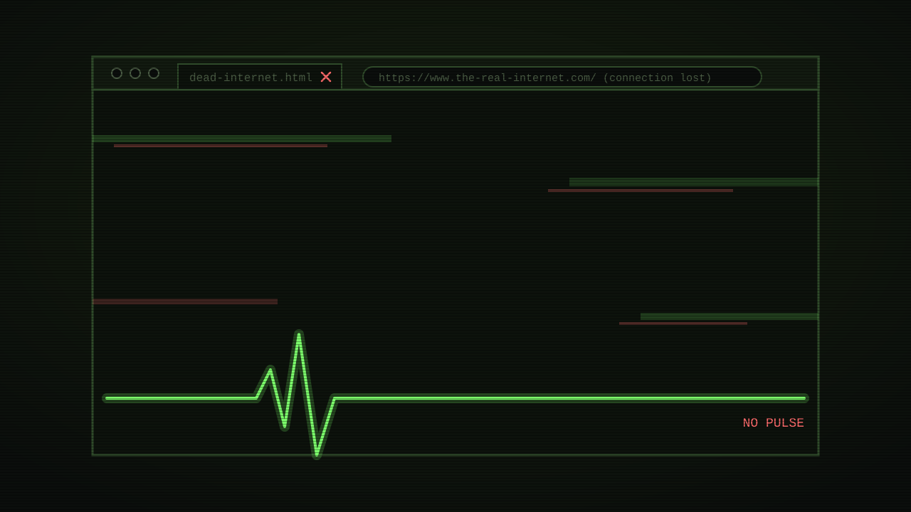
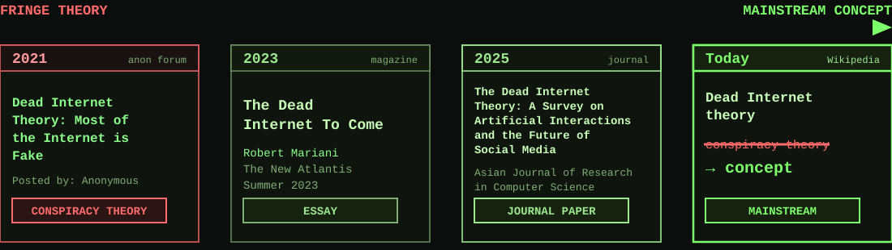
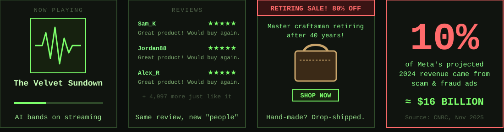
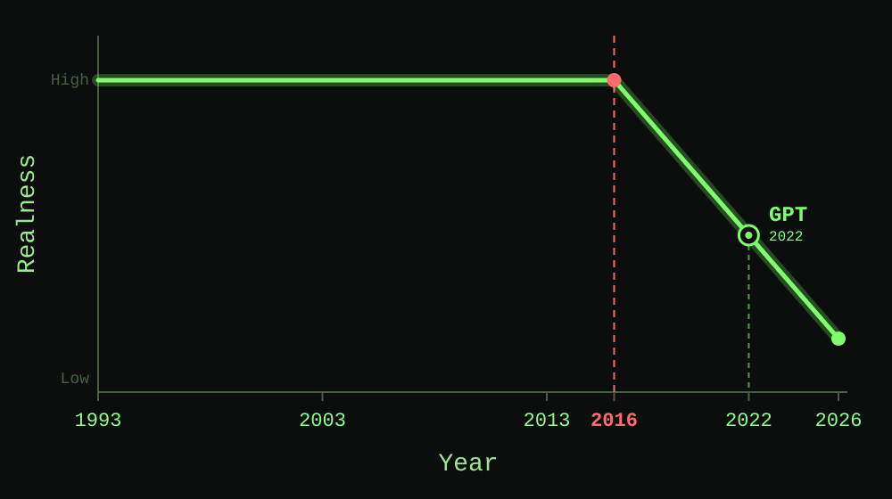
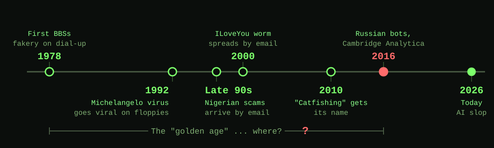
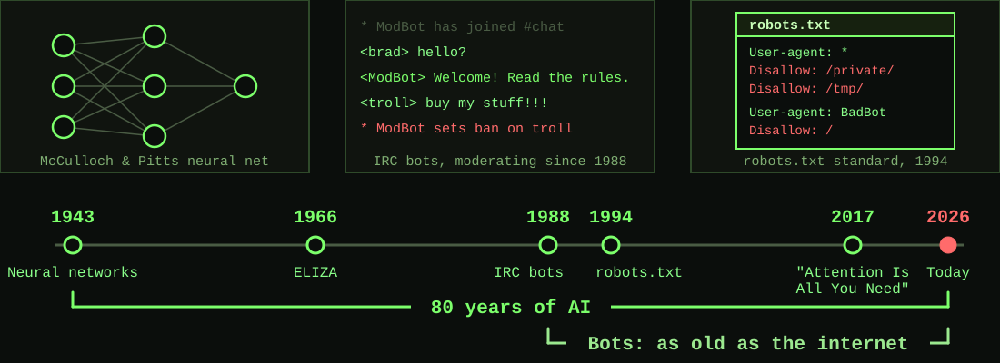
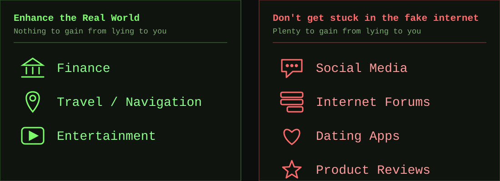
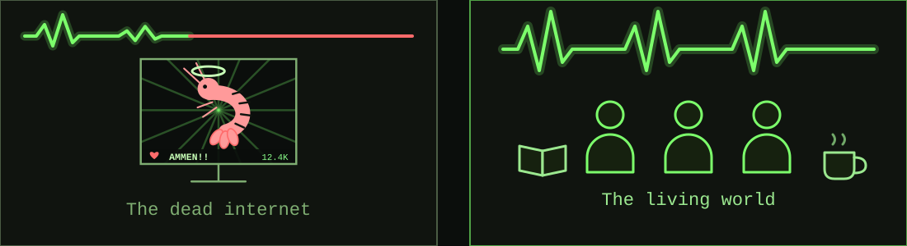

<!-- _class: title -->

# Zombieland
## Surviving the Dead Internet

### Bradford Sherman (@mr-sherman)
https://www.phishcutter.org
August 2026

---

<!-- _class: image -->

## Dead Internet Theory

---

<!-- _class: image -->

## This Feels Real

---
## Did the Internet Start to Die in 2016?
<!-- _class: image -->

---
## Was There an Internet Golden Age?

---
<!-- _class: image -->

## Did AI Kill the Internet?

---

<!-- _class: image -->

## No One Planned This

"We believed that if we connected every human being on earth with each other and all the world's information ...[it] would be an unambiguous good...No one sat down and resolved to build a technology that would polarize democracies and unsettle a generation of young people.  That was not our plan.  *But it happened*." 
 - Eric Schmidt, May 2026

---

## Surviving the Dead Internet

<!-- _class: image -->

---

<!-- _class: image -->

## Thrive in the Living World

Use the Internet to enhance real world experiences.  Go out and meet people

---

<!-- _class: conclusion -->

## Citations

- Dead Internet Theory, original posts
  - https://forum.agoraroad.com/index.php?threads/dead-internet-theory-most-of-the-internet-is-fake.3011/
- Fake Facebook Ad Revenue 
  - https://www.cnbc.com/2025/11/06/meta-reportedly-projected-10percent-of-2024-sales-came-from-scam-fraud-ads.html
- Reddit co-founder admitting early users were fake:
  - https://www.youtube.com/watch?v=zmeDzx4SUME
- Original paper on neural networks:
  - https://www.cs.cmu.edu/~epxing/Class/10715/reading/McCulloch.and.Pitts.pdf
- "The Dead Internet To Come," Robert Mariani, The New Atlantis, Summer 2023
- "The Dead Internet Theory: A Survey on Artificial Interactions and the Future of Social Media," Muzumdar, Cheemalapati, Ramireddy, et al., Asian Journal of Research in Computer Science, March 2025

